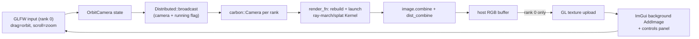

# Real-time render viewer (GLFW + OpenGL + Dear ImGui)

Handoff document for continuing this work on another machine. Do not edit the Cursor plan file; treat this as the repo-local source of truth.

## Status (2026-08-05)

| Task | Status |
|------|--------|
| `CARBON_BUILD_VIEWER` + `cmake/CarbonViewer.cmake` | Done |
| `Distributed::broadcast(void*, bytes, root)` | Done |
| `examples/viewer/carbon_viewer.{h,cpp}` + `render_rgb_utils.h` | Done |
| `--interactive` wired into all render examples | Done |
| Build + `ctest` + `format-check` verification | Done (2026-07-29, see notes) |
| Browser backend (`--web`, imgui-ws / WebSocket) | Done (2026-07-29) |
| `render_wind_tunnel` `--web` with Speed / Q-criterion selector | Done (2026-08-05) |

**Verification notes (2026-07-29, second machine — 2×RTX 6000 Ada):**

- **Toolkit/driver match matters.** The installed driver (580.95.05) supports CUDA
  13.0; `/usr/local/cuda` symlinks to the **13.1** toolkit. Building with 13.1 makes
  every device launch fail at runtime with `CUDA_ERROR_UNSUPPORTED_PTX_VERSION`
  (gpu error 222). Configure against 13.0 to match the driver:
  `cmake -S . -B build -DCUDAToolkit_ROOT=/usr/local/cuda-13.0 -DCMAKE_CUDA_COMPILER=/usr/local/cuda-13.0/bin/nvcc`.
- **ctest:** 87/87 pass pinned to a single GPU (`CUDA_VISIBLE_DEVICES=0`). With both
  GPUs visible, 13 cross-device tests fail (`halo_*`, `skeleton*`, `mgrid_*`,
  `block_reduce`, `render_ray_march` multi-GPU, ...) because peer copies between the
  two cards return stale sentinel data on this box (P2P transport issue in the
  environment, despite `nvidia-smi topo -p2p r` reporting OK) — not a code defect;
  every one of them passes single-GPU.
- **Compile fix:** ImGui 1.91.5 makes `ImTextureID` a 64-bit integer, so the old
  `reinterpret_cast<ImTextureID>(intptr_t)` in `examples/viewer/carbon_viewer.cpp`
  no longer compiles. Changed to `static_cast<ImTextureID>(texture)`.
- **clang-format:** `.clang-format` uses `BinPackParameters: AlwaysOnePerLine`, which
  needs clang-format **>= 20** (18 cannot parse the config). Ran the `format` target
  with clang-format 22 to normalize the render/viewer files (the prior session never
  completed the triad); `format-check` is now clean. Also bumped `ci.yml` off its
  stale `clang-format==18.1.8` pin to `clang-format>=20`, and corrected the "18+"
  notes in `AGENTS.md` / `README.md` / rule / runbook.
- **Interactive:** headless fallback verified (no display → warns, writes file). A real
  orbit/zoom/pan test still requires a machine with a display attached to rank 0's GPU.

## Browser backend (`--web`, imgui-ws)

For headless boxes (SSH-only, no X11/Wayland/VNC), the viewer can serve the render
to a **web browser** over WebSockets instead of opening a local GLFW window — same
`OrbitCamera`, same `render_fn`, same collective MPI loop.

- Option `CARBON_VIEWER_WEB` (default `ON`; only takes effect with
  `CARBON_BUILD_VIEWER=ON`). `cmake/CarbonViewerWs.cmake` vendors the stack via
  `FetchContent`, all pinned and **no-SSL** (OpenSSL not required; zlib is used for
  WebSocket permessage-deflate):
  - `ggerganov/imgui-ws` → `ggerganov/incppect` → `uNetworking/uWebSockets` →
    `uNetworking/uSockets`, each fetched individually (submodules off) and compiled
    by our module — **not** each project's own CMake — so (a) imgui-ws links carbon's
    single `carbon_imgui` (no second Dear ImGui / ODR), and (b) incppect's forced
    `Incppect<true>` (SSL) instantiation is patched out to drop the OpenSSL dep.
  - Exposes `carbon::imgui_ws`; `carbon_viewer` links it and defines
    `CARBON_HAVE_VIEWER_WEB`.
- `Viewer::run_web(sys, initial, render_fn, {port, tex_edge})`: rank 0 runs an
  `ImGuiWS` server; other ranks run the same collective broadcast loop. The rendered
  frame is nearest-downscaled + letterboxed into a **power-of-two** RGB texture
  (`tex_edge`, default 1024; the imgui-ws JS client uses a WebGL1 context, which needs
  POT textures), streamed each camera change; browser mouse/wheel events drive the
  orbit camera (DOM button → ImGui button remap; `WantCaptureMouse` guards the panel).
- The HTML client is served from memory (`addResource("/index.html", ...)`); incppect
  serves `/incppect.js` and imgui-ws serves `/imgui-ws.js` automatically. No files on disk.

```bash
cmake -S . -B build-viewer-web -DCARBON_BUILD_VIEWER=ON \
      -DCARBON_VIEWER_DESKTOP=OFF -DCARBON_VIEWER_WEB=ON
cmake --build build-viewer-web -j
./build-viewer-web/examples/carbon_example_render_density --web --port 5000
CARBON_WT_ITERS=8000 ./build-viewer-web/examples/carbon_example_render_wind_tunnel --web --port 5000
# then open http://<host>:5000/  (SSH tunnel: ssh -L 5000:localhost:5000 <host>)
```

Verified end-to-end headless on 2026-07-29 by driving headless Chrome over the
DevTools Protocol (real-time wait for WebSocket frames): the density sphere streams
into the WebGL canvas and the ImGui controls overlay renders and is interactive.

## Recommendation

**GLFW + OpenGL + Dear ImGui.** Standard for scientific/GPU visualizers: tiny, permissive, trivial to vendor via `FetchContent`, and it composes cleanly with a CUDA/SYCL/HIP codebase because the window/UI layer stays pure host C++ and never touches device code. The GPU already produces the frame; the viewer presents the combined host RGB buffer as a texture and feeds an orbit `carbon::Camera` back into the (cheap, type-erased) render `Kernel` each interaction.

Chosen scope: a **reusable viewer helper** wired into **all three** examples, **static-field orbit** (solve once, re-render on camera change), keeping **multi-GPU/MPI** host-combine each frame.

## Architecture



Only rank 0 opens a window; the loop is collective so every rank runs `render_fn` (which internally does `combine`/`dist_combine`). Camera + a `running` flag are broadcast from rank 0 each iteration. Re-render only fires when the camera is dirty (static field), so idle frames are cheap.

## Build system

- Option `CARBON_BUILD_VIEWER` (default `OFF`) in `CMakeLists.txt` near the other `CARBON_BUILD_*` options. Headless HPC/CI nodes stay unaffected.
- `cmake/CarbonViewer.cmake` (mirrors `cmake/CarbonSpdlog.cmake`): `find_package(OpenGL REQUIRED)`, `FetchContent` GLFW (`glfw/glfw`, tag `3.4`, with `GLFW_BUILD_{DOCS,TESTS,EXAMPLES}=OFF`) and Dear ImGui (`ocornut/imgui`, `v1.91.5`). ImGui has no CMake, so define an `imgui` static lib from its core sources + `backends/imgui_impl_glfw.cpp` + `backends/imgui_impl_opengl3.cpp` (GL3 backend bundles its own loader; no GLAD needed).
- Include `CarbonViewer.cmake` from the root only under `if(CARBON_BUILD_VIEWER)`.

Configure with viewer:

```bash
cmake -S . -B build-viewer -DCARBON_BUILD_VIEWER=ON
cmake --build build-viewer -j
```

Default build (viewer off, unchanged CI path):

```bash
cmake -S . -B build
cmake --build build -j
ctest --test-dir build --output-on-failure
cmake --build build --target format-check
```

## Reusable viewer helper (`examples/viewer/`)

- `carbon_viewer.h` / `carbon_viewer.cpp` — pure host C++, links `carbon::carbon`, `carbon::imgui`, `glfw`, `OpenGL::GL`. Static lib `carbon_viewer`, built only when `CARBON_BUILD_VIEWER`.
- `render_rgb_utils.h` — host RGB export helpers for `DensityImage` / `RayMarchImage` / composited layers.
- `OrbitCamera`: `target`, `distance`, `azimuth`, `elevation`, `fov_y_rad`, `up`, `bounds_min/max`; `to_camera(w,h)` and `from_frame_bounds(...)`.
- `Viewer::run(sys, initial, render_fn)`:
  - Left-drag = orbit, scroll = zoom, right-drag = pan.
  - Rank 0: GLFW + ImGui + GL texture upload.
  - All ranks: collective loop; `Distributed::broadcast` syncs camera + running + dirty flags.
  - `render_fn(camera, w, h, rgb_out)` fills interleaved RGB in `[0, 1]`.

## Public MPI broadcast primitive

- `void Distributed::broadcast(void* data, size_t bytes, int root) const` in `include/carbon/distributed.h`, implemented in `src/distributed.cpp` as host `MPI_Bcast` (pImpl; no `<mpi.h>` in consumer TUs). Only compiled when `CARBON_ENABLE_MPI=ON` / `CARBON_HAVE_MPI_NCCL`.

## Example integration

All three examples accept `--interactive` when built with `CARBON_BUILD_VIEWER=ON` (`CARBON_HAVE_VIEWER` defined on the example target). Without the viewer, behaviour is unchanged (file output only).

```bash
./build-viewer/examples/carbon_example_render_density --interactive
./build-viewer/examples/carbon_example_render_ray_march --interactive
./build-viewer/examples/carbon_example_render_wind_tunnel --interactive
```

Optional output path still works: `./build-viewer/examples/carbon_example_render_density out.pgm --interactive`

- `render_density.cu`: `make_density_kernel` + `rgb_from_density`.
- `render_ray_march.cu`: `make_ray_march_kernel` + `rgb_from_ray_march` (MinMax luminance tone map).
- `render_wind_tunnel.cu`: LBM solve once; per frame ray-marches speed or Q-criterion (runtime
  selector) plus the cylinder SDF, composited over a white background. The `--web` backend
  renders at 1280×720; file output still writes separate speed and Q PPMs plus a VTI volume.

Interactive mode needs a display (X11/Wayland/VNC). If rank 0 has no display, examples log a warning and fall back to file output.

## Verify checklist

- [x] `cmake --build build -j && ctest --test-dir build --output-on-failure && cmake --build build --target format-check` (87/87 single-GPU; format-check clean with clang-format 20+; see notes on the multi-GPU P2P env failures)
- [x] `cmake -S . -B build-viewer -DCARBON_BUILD_VIEWER=ON && cmake --build build-viewer -j`
- [ ] Run `--interactive` on at least one example with a GPU + display; confirm orbit/zoom/pan. (headless fallback verified; needs a display for the real interaction test)
- [ ] Under MPI (optional): `mpiexec -n N ./build-viewer/examples/carbon_example_render_ray_march --interactive`
- [x] Browser backend: `--web` serves index.html/incppect.js/imgui-ws.js (HTTP 200) and streams the render to a WebGL canvas with an interactive ImGui overlay (verified via headless Chrome + CDP)

## Open follow-ups (out of scope)

- Live simulation stepping (pause/resume) while orbiting.
- Single-GPU CUDA–GL interop zero-copy (skip D2H when `gpu_count()==1` and no MPI).

## Files touched in this effort

- `CMakeLists.txt` — `CARBON_BUILD_VIEWER` + `CARBON_VIEWER_WEB` options
- `cmake/CarbonViewer.cmake` — FetchContent GLFW + ImGui
- `cmake/CarbonViewerWs.cmake` — FetchContent imgui-ws + incppect + uWebSockets + uSockets (no-SSL)
- `examples/CMakeLists.txt` — `carbon_viewer` static lib + `_carbon_example_link_viewer` (+ `carbon::imgui_ws` link)
- `examples/viewer/carbon_viewer.{h,cpp}` (`run_web`), `examples/viewer/render_rgb_utils.h`
- `include/carbon/distributed.h`, `src/distributed.cpp` — `broadcast`
- `examples/render_density.cu`, `examples/render_ray_march.cu`, `examples/render_wind_tunnel.cu`
- `src/gpu.cpp` — CUDA 13+ guard for removed `cudaDeviceProp::clockRate` fields (unblocks local build on CUDA 13.1)
